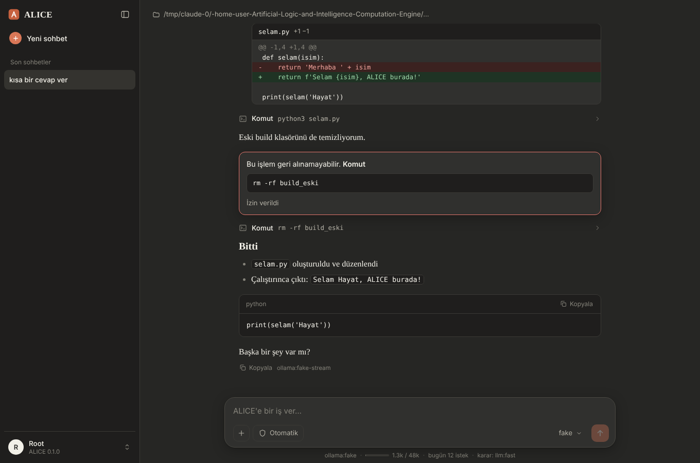
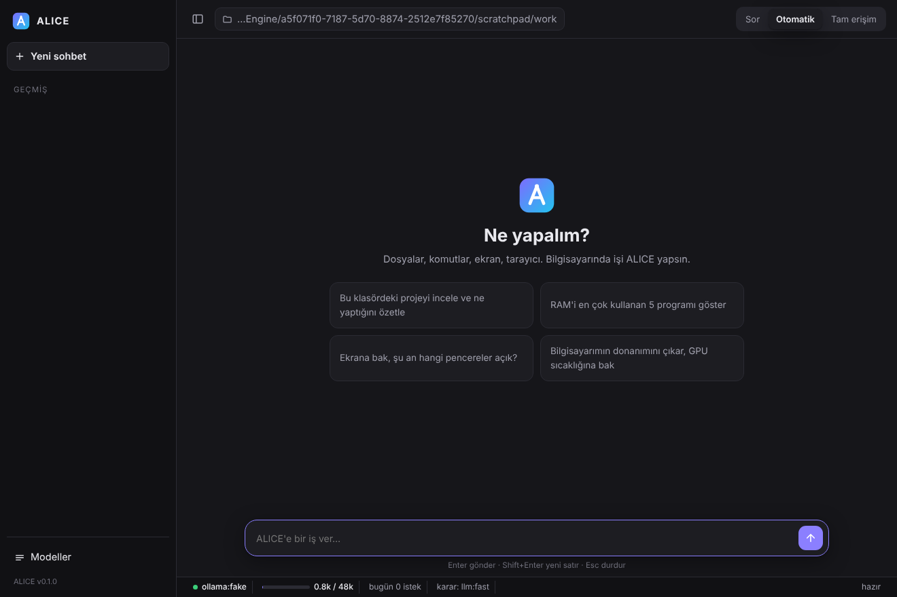
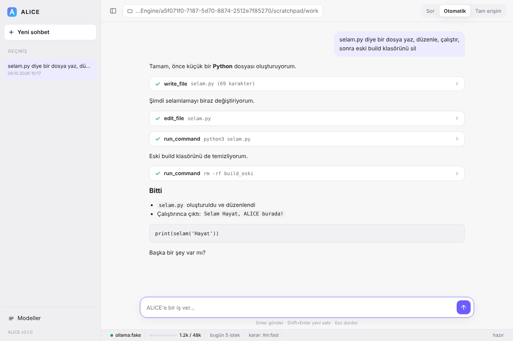
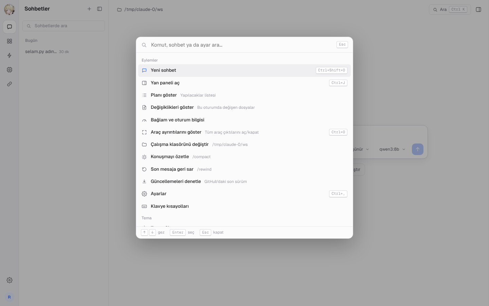
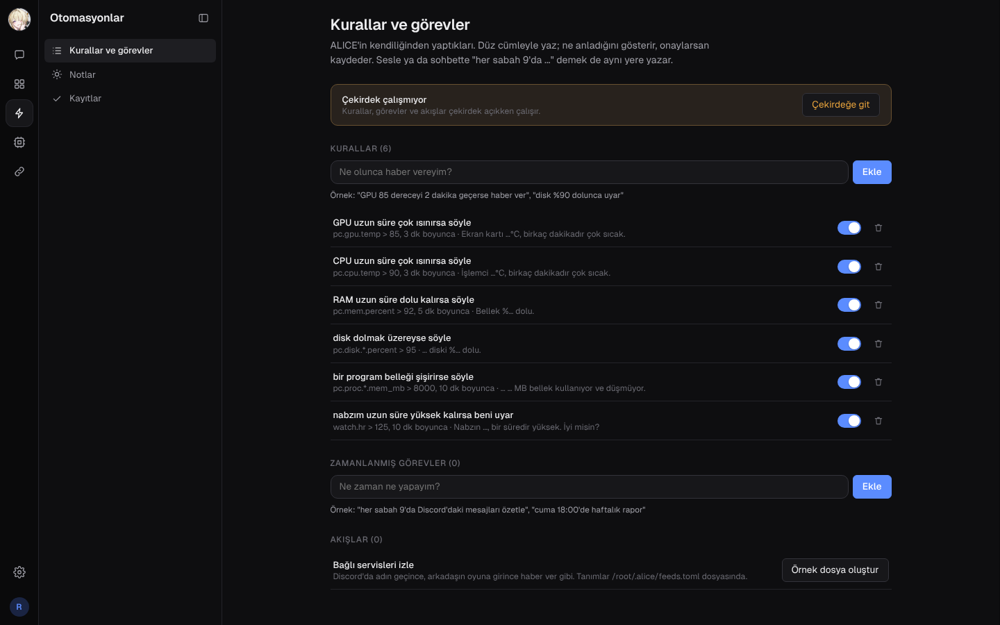

# ALICE

**Artificial Logic and Intelligence Computation Engine.** Bilgisayarında çalışan, Claude Code / Codex tarzı bir ajan harness. Fark şu: tek bir ücretli modele bağlı değil, ücretsiz API katmanlarını sırayla kullanıyor ve hızlı arayüz kararları için Jev gibi System One modelleri kullanabiliyor.

Neler yapabiliyor:

* Dosya okuma/yazma/düzenleme, kod tabanında arama (`grep`, `glob`)
* PowerShell/bash komutları, arka planda sunucu çalıştırıp çıktısını izleme
* Ekran görüntüsü alıp fare ve klavyeyi kullanma (Türkçe karakter yazabiliyor)
* Windows UI Automation ile pencerelerin butonlarını ID'leriyle görüp tıklama (pixel tahmini yok)
* Gerçek tarayıcıyı kontrol etme (kalıcı profil, bir kere giriş yaptığın siteler açık kalıyor)
* Uygulama açma, pencere yönetimi, süreç listeleme/öldürme, sistem bilgisi, pano
* Web arama (anahtarsız) ve sayfa okuma
* **Reflex modu:** net bir arayüz hedefini System One kararlarıyla adım başına ~100-500 ms'de yürütme
* Alt ajan, todo planı, oturumlar arası hafıza, oturum kaydetme/devam ettirme, otomatik context özetleme
* **İki arayüz:** masaüstü uygulaması (Claude Code / Codex masaüstü gibi) ve terminal. İkisinde de akışlı cevap, renkli diff, durum çubuğu ve çok satırlı yazma var



## Mimari

```
                 ┌──────────────────────── ALICE ────────────────────────┐
  sen ──► CLI ──►│ Agent (System 2)                                       │
                 │   brain modeli ⇄ araçlar (dosya, shell, ekran, UIA,    │
                 │                  tarayıcı, web, sistem, alt ajan)      │
                 │        │                                               │
                 │        └─► reflex aracı ──► ReflexLoop (System 1)      │
                 │              observe → aday listesi → Decider → act    │
                 │                                   │                    │
                 │                    Jev ──(yoksa)──► hızlı LLM (JSON)   │
                 │                                                        │
                 │ Router: her rol için sağlayıcı zinciri + otomatik geçiş│
                 └────────────────────────────────────────────────────────┘
```

**İki sistemli yapı.** Büyük model (brain) planlar, kod yazar, karar verir. Ama "Ayarlar'a gir, Gizlilik'e tıkla, şu kutuyu işaretle" gibi işlerde her tıklamayı büyük modele sormak hem yavaş hem free tier kotasını yakıyor. O yüzden brain bu tür alt hedefleri `reflex` aracına devrediyor:

1. Ekran ID'li bir aday listesine çevriliyor (tarayıcıda DOM, Windows'ta UI Automation)
2. Hedefle en alakalı 40 aday seçiliyor
3. Tek bir System One çağrısı: "sıradaki aksiyon hangisi?" + "hedef tamam mı?"
4. Seçilen aksiyon uygulanıyor, metin yazmak gerekiyorsa hızlı LLM üretiyor
5. Düşük güven, aynı aksiyonun tekrarı ya da "stuck" olursa kontrol brain'e geri dönüyor

Bu, Cua'nın `jev-use` tarifiyle aynı mantık: Jev bir ajan değil, bir karar bileşeni.

## Model seçimi: neden bu sıra

Ekim 2026 itibarıyla ücretsiz katmanları taradım. Rakamlar sık değişiyor, kaynaklar birbiriyle çelişebiliyor; aşağıdaki tablo kararın gerekçesi, kesin limit için her sağlayıcının kendi panelini kontrol et.

| Sağlayıcı | Ücretsiz olarak ne veriyor | ALICE'teki rolü |
|---|---|---|
| **Google Gemini (AI Studio)** | Flash ve Flash-Lite ücretsiz, 1M context, görsel destekli. Pro modeller Nisan 2026'da free tier'dan çıktı. Free tier verileri ürün geliştirmede kullanılabiliyor. | **brain #1, vision #1.** Büyük context + görsel tek modelde, ajan için en uygun ücretsiz seçenek |
| **OpenRouter** | `:free` modeller 20 RPM / günde 50 istek; tek seferlik 10$ yüklemeyle günde 1000. Katalog birkaç ayda bir değişiyor (gpt-oss-120b, Poolside Laguna, North Mini Code vb.) | brain yedeği, `openrouter/free` son çare router |
| **NVIDIA NIM** | Developer Program ile ~40 RPM (hesap bazlı), qwen3-coder-480b, deepseek gibi büyük modeller | brain yedeği, güçlü kodlama modeli |
| **Groq** | Günde 1000 istek ama dakikada 8K, günde 200K token. Llama ve Kimi kaldırıldı, gpt-oss duruyor. Çok hızlı | **fast #1.** Kısa işler ve Jev emülasyonu için ideal, büyük context'e uygun değil |
| **Cerebras** | Son raporlara göre süreli kredi, kalıcı free tier belirsiz | yedek |
| **Ollama (yerel)** | Limitsiz, offline, GPU'na bağlı | her zincirin sonunda son çare |

**Tek sağlayıcıya güvenmiyorum.** Router her rol için bir zincir tutuyor. 429 gelince o model soğumaya alınıyor ve sıradakine geçiliyor, günlük kota dolunca 1 saat, anahtar yanlışsa sağlayıcı oturum boyunca, model katalogdan kalkmışsa o model kapatılıyor. İstek bir sağlayıcının token sınırını aşıyorsa (Groq'un 8K TPM'i gibi) o sağlayıcı o istek için atlanıyor. Yani bir sağlayıcı düşse de ALICE çalışmaya devam ediyor.

Katalog değiştiğinde `alice models --write` canlı `/models` uçlarını tarayıp zincirleri güncelliyor.

### Jev hakkında net bilgi

Jev (TypeSafe AI, Eylül 2026) metin üretmeyen, tipli karar veren bir System One modeli. **Ücretsiz katmanı yok**: girdi tokenı başına 0.042$/milyon, çıktı ücretsiz, şu an erken erişim listesiyle. Pratikte bu çok ucuz (bir reflex adımı ~1-2K token, yani milyonlarca karar birkaç dolar), ama sen ücretsiz istediğin için şöyle kurdum:

* `TYPESAFE_API_KEY` varsa karar motoru Jev (REST `POST /v1/systemone`, Choice/Noul/Score soruları)
* TypeSafe yeni kayıtları durdurduğu için Jev'e **OpenRouter üzerinden** de gidiliyor (`~typesafe/jev-latest`, aynı `OPENROUTER_API_KEY`). Burada da `:free` sürümü yok, hesapta kredi olmalı; kredi yoksa OpenRouter 402 döner, ALICE bunu görünce Jev'i 1 saat atlayıp yedeğe geçer
* Yoksa ya da Jev hata verirse aynı soru formatı, `fast` rolündeki ücretsiz hızlı modele (Groq gpt-oss-20b, `reasoning_effort=low`) JSON olarak soruluyor

Yani reflex modu anahtarsız da çalışıyor, sadece daha yavaş: Jev için bildirilen süre ~100-350 ms, Groq yedeği ise benim tahminimle adım başına birkaç yüz ms ile 1-2 sn arası (ölçmek için `alice doctor` karar süresini yazıyor). Jev erişimi alırsan tek satır anahtar eklemen yetiyor. Jev'e Score soruları güvenli olsun diye Choice olarak gidiyor, çünkü resmi dokümanda en net belgelenen format o.

## Kurulum (Windows)

Python 3.10+ lazım (python.org, "Add to PATH" işaretli).

```powershell
git clone https://github.com/hayatexe/Artificial-Logic-and-Intelligence-Computation-Engine
cd Artificial-Logic-and-Intelligence-Computation-Engine
powershell -ExecutionPolicy Bypass -File install.ps1
```

Script `.venv` açıyor, her şeyi kuruyor, Chrome/Edge yoksa Playwright Chromium indiriyor ve `alice init` çalıştırıyor. Elle yapmak istersen:

```powershell
python -m venv .venv
.\.venv\Scripts\activate
pip install -e ".[all]"
alice init
```

Linux/macOS'ta aynısı, `pip install -e ".[all]"` sonrası `alice init`. Linux'ta pencere listesi için `wmctrl` lazım; UI Automation şimdilik sadece Windows'ta.

### API anahtarları

`alice init` `%USERPROFILE%\.alice\.env` dosyasını oluşturuyor. En az birini doldur, hepsini doldurursan zincir o kadar dayanıklı olur:

* `GEMINI_API_KEY`: https://aistudio.google.com/apikey (en önemlisi bu)
* `GROQ_API_KEY`: https://console.groq.com/keys (reflex ve hızlı işler için)
* `OPENROUTER_API_KEY`: https://openrouter.ai/keys
* `NVIDIA_API_KEY`: https://build.nvidia.com
* `CEREBRAS_API_KEY`: https://cloud.cerebras.ai
* `TYPESAFE_API_KEY`: Jev erişimi alırsan

Sonra:

```powershell
alice doctor          # her sağlayıcıya test isteği atar, karar motorunu dener, eksik paketleri gösterir
alice models --write  # canlı ücretsiz katalogdan rol zincirlerini günceller (opsiyonel)
```

## Masaüstü uygulaması

`install.ps1` masaüstüne ve Başlat menüsüne **ALICE** kısayolu koyuyor (Windows tuşuna basıp "ALICE" yazarak da bulunur), çift tıklayınca konsol penceresi olmadan uygulama açılıyor. Elle açmak için `alice app`, kısayolu yeniden oluşturmak için `alice shortcut`.



**Görünüm:** sıcak krem/kömür renkler, cevaplarda serif yazı, araç çağrıları sade açılır satırlar. Yeni sohbette selamlama ve yazma kutusu ortada duruyor. Tema Windows ayarını izliyor ya da Ayarlar'dan açık/koyu sabitlenebiliyor.

**Yazma kutusu**
* Enter gönderir, Shift+Enter yeni satır açar.
* `/` yazınca komut listesi, `@` yazınca dosya/klasör önerileri açılıyor. `@src/main.py` yazdığın dosyanın içeriği mesajla birlikte modele gidiyor.
* Görseli yapıştırabilir (Ctrl+V), sürükleyip bırakabilir ya da `+` ile ekleyebilirsin.
* ALICE çalışırken yazdığın mesaj **sıraya** giriyor ve iş bitince otomatik gönderiliyor.
* Kutunun içinde izin modu (Shift+Tab ile döner) ve model seçici var.

**Sohbet**
* Cevaplar akarak geliyor. Model akıl yürütme metni gönderiyorsa açılır bir "düşündü" bölümü olarak görünüyor.
* Her araç satırında çalışırken dönen bir gösterge ve canlı süre var. Bitince yeşil ya da kırmızı nokta, süre ve sonucun ilk satırları görünüyor.
* Dosya düzenlemeleri satır numaralı, renklendirilmiş diff olarak açılıyor. Komutlar terminal görünümünde, çıkış koduyla gösteriliyor.
* Kod blokları sözdizimine göre renkleniyor (Python, JS/TS, PowerShell, bash, JSON, CSS, Lua, SQL, C ailesi...).
* ALICE plan tuttuğunda görev listesi ilerleme çubuğuyla çiziliyor. İş sürerken mesaj kutusunun üstünde o anki görev duruyor.
* Tehlikeli işlemde sohbetin içinde "İzin ver / Bu oturumda hep izin ver / Reddet" kartı çıkıyor. 1, 2, 3 tuşlarıyla da cevaplanıyor.
* Her işin sonunda süre, araç sayısı ve değişen dosyalarla tek satırlık bir özet çıkıyor.
* Kod bloklarında ve cevaplarda Kopyala butonu var.

**Yan panel (Ctrl+J):** üç sekme var.
* **Plan:** güncel görev listesi.
* **Değişiklikler:** bu oturumda değişen bütün dosyalar +/− sayılarıyla. Her dosyanın farkı açılıyor, dosya bazında **Geri al** var. Üst çubuktaki `+12 −3` düğmesi de buraya açılıyor.
* **Bağlam:** context doluluğu, model, mod, klasör, git dalı ve oturum bilgisi.

**Komut paleti (Ctrl+K):** eylemler, izin modları, düşünme seviyeleri, modeller, slash komutları ve geçmiş sohbetler tek arama kutusunda.

**Ayarlar (Ctrl+,):** Genel (tema, yazı boyutu, araç ayrıntıları, yan panel, izin modu, klasör), Modeller, Araçlar, Hafıza, Kullanım ve Kısayollar sekmeleri.

**Geri sarma**
* Her mesajın altında **Düzenle** ve **Geri sar** var. Konuşma o mesajın öncesine dönüyor.
* ALICE'in o mesajdan sonra dosya araçlarıyla değiştirdiği ya da oluşturduğu dosyalar eski haline geliyor. Shell komutlarının yaptığı değişiklikler izlenemiyor.

**Kenar çubuğu:** yeni sohbet, sohbetlerde arama, Bugün/Dün/Bu hafta diye gruplanmış geçmiş (üzerine gelince sil), altta Ayarlar. Ctrl+B ile gizlenip açılıyor.

**Durum satırı:** cevap veren model, context doluluğu, bugünkü istek sayısı, karar motoru, git dalı ve oturum süresi.

**Pencere ve güvenlik:** Pencere sırasıyla şöyle açılıyor: pywebview kuruluysa gerçek bir uygulama penceresi (Windows'ta Edge WebView2), değilse Edge/Chrome'un adres çubuğu olmayan uygulama modu, o da yoksa varsayılan tarayıcı. Arayüz sadece `127.0.0.1`'de çalışıyor ve her açılışta değişen rastgele bir token istiyor. Böylece tarayıcıda açık başka bir site ALICE'e komut gönderemiyor. Model çıktısı ekrana basılmadan önce DOMPurify ile temizleniyor.







## Claude Code'daki özellikler

| Özellik | ALICE'te |
|---|---|
| Plan modu | `/plan` ya da mod menüsü: sadece okur/araştırır, değişiklik yapan araçlar reddedilir, plan yazar |
| Geri sarma (checkpoint) | Mesaj altındaki Geri sar / Düzenle ya da `/rewind`. Dosya araçlarının değişiklikleri geri alınır |
| `@dosya` bahsetme | Dosya içeriği ya da klasör listesi mesaja eklenir, uygulamada otomatik tamamlama var |
| Slash komutları | Yerleşikler + `~/.alice/commands/*.md` ve projede `.alice/commands/*.md` (`.claude/commands` da okunur) |
| `/init` | Projeyi inceleyip `ALICE.md` talimat dosyası yazar |
| MCP sunucuları | `config.toml`'da `[mcp.servers.<isim>]`, araçlar `mcp__<sunucu>__<araç>` olarak eklenir |
| Proje talimatları | `ALICE.md`, `CLAUDE.md`, `AGENTS.md` ve `~/.alice/ALICE.md` otomatik okunur |
| Alt ajan, todo, hafıza, context özetleme, oturuma devam | var |
| Mesaj kuyruğu, görsel yapıştırma, düşünme gösterimi | var (uygulamada) |
| Çoklu düzenleme (MultiEdit) | `multi_edit`: bir dosyada birden fazla değişiklik tek çağrıda; biri bile tutmazsa dosyaya hiçbir şey yazılmaz |
| Paralel araç çağrıları | Model tek cevapta birkaç okuma/arama isterse (`read_file`, `grep`, `glob`, `list_dir`, `web_search`, `web_fetch`, salt okuma MCP araçları) aynı anda çalışır; sonuçlar sırayla modele döner |
| Araç gruplama | Art arda gelen okumalar uygulamada "2 dosya okundu, 1 arama yapıldı" diye tek açılır satır olur, terminalde her biri tek satır |
| Hook'lar | yok |

**Özel komut örneği**, `~/.alice/commands/incele.md`:

```markdown
---
description: Değişiklikleri incele
---
Bu projedeki son değişiklikleri incele, hataları ve riskli yerleri listele. Odak: $ARGUMENTS
```

Sonra `/incele performans` yazınca bu metin `$ARGUMENTS` yerine "performans" konmuş halde gider.

**MCP örneği**, `config.toml`:

```toml
[mcp.servers.dosyalar]
command = "npx"
args = ["-y", "@modelcontextprotocol/server-filesystem", "C:/Users/hayat/Projeler"]

[mcp.servers.github]
command = "npx"
args = ["-y", "@modelcontextprotocol/server-github"]
env = { GITHUB_PERSONAL_ACCESS_TOKEN = "..." }
```

Sunucu başlamazsa hata uygulamada not olarak görünüyor, ayrıntısı `~/.alice/mcp-<isim>.log` dosyasında.

## Terminal

```powershell
alice                                   # etkileşimli oturum
alice "bu klasördeki Unity projesinde PlayerController'daki zıplama bug'ını bul ve düzelt"
alice -p "RAM'i en çok yiyen 5 süreci listele"   # tek seferlik, sonucu yazıp çıkar
alice --yolo                            # hiçbir şey sormadan tam erişim
alice --resume                          # son oturuma devam
alice -v                                # hangi modelin cevap verdiğini göster
```

Reflex'i tek başına denemek için:

```powershell
alice reflex "Ayarlar sayfasını açıp Gizlilik sekmesine geç" --target browser --url https://github.com
alice reflex "Kaydet butonuna bas" --target desktop --title "Not Defteri"
alice reflex "hava durumunu ara" --target browser --url https://duckduckgo.com --input "ara=ankara hava durumu"
```

Terminalde cevap akarak geliyor, dosya düzenlemeleri renkli diff olarak görünüyor, altta model, izin modu, context doluluğu ve bugünkü istek sayısını gösteren bir durum çubuğu var. Çok satırlı yazmak için **Alt+Enter** ya da satırı `\` ile bitirip Enter (her terminalde çalışır); Enter tek başına gönderir.

REPL komutları: `/help`, `/plan`, `/mode plan|ask|auto|yolo` (Shift+Tab ile de döner), `/model` (zincir durumları), `/model brain groq:openai/gpt-oss-120b` (sabitle), `/rewind`, `/init`, `/usage`, `/compact`, `/clear`, `/sessions`, `/resume`, `/cwd`, `/tools`, `/mcp`, `/memory`, `/exit`. Özel komutlar ve `@dosya` terminalde de çalışıyor.

## Arka plan çekirdeği

ALICE'in altında, sen yazmasan da çalışan küçük bir servis var. Bilgisayarı izliyor, uzun süren sorunlarda haber veriyor, ortama göre mod değiştiriyor ve zamanlanmış görevleri çalıştırıyor.

```powershell
pip install -e ".[core]"     # sistem tepsisi simgesi için (opsiyonel)
alice core install           # Windows açılınca tepside sessizce başlasın
alice core run --tray        # şimdi başlat (ya da sadece: alice core run)
alice core status            # çalışıyor mu, hangi mod, son bildirimler
alice core mode flight       # modu elle sabitle; alice core mode auto ile otomatiğe dön
alice core stats "pc.gpu.*" 1d
```

**Veri.** Her 15 saniyede CPU, RAM, disk, en çok kaynak kullanan programlar, öndeki pencere ve (NVIDIA kartta) GPU sıcaklığı/kullanımı `~/.alice/core.db` dosyasına yazılır, 30 gün saklanır. Windows'ta CPU sıcaklığı için [LibreHardwareMonitor](https://github.com/LibreHardwareMonitor/LibreHardwareMonitor) açık olmalı (psutil Windows'ta sıcaklık vermiyor). ALICE'e "dün DCS oynarken GPU kaç dereceydi?" diye sorabilirsin; `metrics` aracıyla uçuş modundaki aralıklara bakar.

**Modlar.** DCS ya da War Thunder açıkken *uçuş*: sadece uçuşla ilgili ve kritik bildirimler geçer, ALICE yerel GPU'yu kullanmaz. Unity ya da editör açıkken *geliştirme*, gece (varsayılan 00:30-08:00) *sessiz*: sadece uyarılar, ses yok. Susturulan bildirimler kaybolmaz, `alice core status` ya da "ben oyundayken ne oldu?" ile görülür. Program listeleri ve politikalar `config.toml` içindeki `[core]` bölümünde.

**Kurallar.** Hazır kurallar: GPU/CPU birkaç dakika çok ısınırsa, RAM uzun süre doluysa, disk dolmak üzereyse, bir program belleği şişirirse. Kendi kuralını cümleyle kurarsın:

```powershell
alice rules add "GPU 80 dereceyi 5 dakika geçerse ve DCS açık değilse söyle"
alice rules                  # liste;  alice rules off gpu-hot  /  alice rules rm <id>
```

Ya da ALICE'e direkt "nabzım uzun süre yüksek kalırsa beni uyar" demen yeter. Karar ucuzdan pahalıya gider: önce kural, durum belirsizse hızlı karar modeli (Jev), gerçekten araştırma gerekiyorsa ALICE'in kendisi.

**Zamanlanmış görevler.**

```powershell
alice tasks add "her pazar gece D:\Unity altındaki projeleri E:\Yedek'e zip'le"
alice tasks                  # liste ve son sonuçlar;  alice tasks run <id>  /  alice tasks rm <id>
```

ALICE cümleyi zamanlamaya çevirip gösterir, onaylarsan kurar. Bilgisayar kapalıyken kaçırılan görev açılışta bir kez telafi edilir. Görevler gözetimsiz çalıştığı için onay gerektiren adımlar (auto modda tehlikeli komutlar) reddedilir; sonuç bildirim olarak gelir.

**Kişilik.** ALICE'in sana nasıl hitap edeceği, ne kadar uzun konuşacağı ve ne sıklıkla şaka yapacağı `~/.alice/personality.md` dosyasında (`alice init` oluşturur), her oturumda okunur.

## Ses

ALICE'in sesi ve kulağı. Önce paketleri kur:

```powershell
pip install -e ".[voice]"          # mikrofon, ses çalma, bas-konuş, konuşma algılama
pip install -e ".[voice-local]"    # opsiyonel: bilgisayarda Whisper ve "Hey Alice" modeli
alice voice status                 # neyin hazır olduğunu gösterir
```

**1. Sesi seç (dinleme testi).** Aday sesler aynı Türkçe cümleleri beş tonda (sakin, neşeli, ciddi, acil, şakacı) seslendirir, sonuç tarayıcıda yan yana açılır:

```powershell
alice voice audition                                   # Gemini sesleri (GEMINI_API_KEY gerekir)
alice voice audition --local xtts,chatterbox           # yerel motorlar da (önce: pip install coqui-tts / chatterbox-tts)
alice voice use gemini:Aoede                           # beğendiğini seç
alice voice library                                    # bu sesle duygu kütüphanesini oluştur
alice voice say "Bingo yakıt, eve dön." --emotion urgent
```

Yerel motorlar sesi duygu kütüphanesindeki kayıtlardan klonlar. Bu yüzden DCS açıkken buluttan, kapalıyken bilgisayardan konuşsa da aynı ALICE duyulur. Uçuş modunda ALICE ekran kartına dokunmaz: önce bulut, yerel motor ancak son çare olarak işlemcide.

**2. Konuş.**

```powershell
alice voice           # sesli asistan: bas-konuş (Scroll Lock) ve "Hey Alice"
alice voice test      # mikrofonu dene
```

* **Bas-konuş:** tuşu basılı tut, konuş, bırak. Tuş `config.toml` içinde `[voice] ptt_key`.
* **"Hey Alice":** el gerektirmez. [openWakeWord](https://github.com/dscripka/openWakeWord) ile kendi eğittiğin bir model (`wake_model`) verirsen tamamen yerelde dinler. Vermezsen konuşma algılanınca cümlenin başı bilgisayardaki küçük Whisper modeliyle (faster-whisper, `[voice] wake_local = "base"`) yazıya çevrilip "Hey Alice" ile başlayıp başlamadığına bakılır; sadece uyandırma duyulursa ses Groq'a gider. faster-whisper kurulu değilse her cümle Groq'a gönderilir. `alice voice on` sesi açar ve arka plandaki çekirdeği başlatır.
* ALICE cevap verdikten sonra 8 saniye boyunca "Hey Alice" demeden devam edebilirsin.
* ALICE konuşurken araya girersen susar ve yarım kalan işi durdurur. Hoparlör yerine kulaklık kullanırsan yankı yüzünden yanlışlıkla susmaz.
* Cevabın tamamını beklemez, ilk cümle hazır olunca söyler. Bir araç çalışacaksa önce "hemen bakıyorum" der. Kod ve uzun yolları okumaz, ekrana yazdığını söyler.
* Onay gereken bir işte sesli sorar, "evet" dersen yapar.
* Konuşma tanıma: Groq'taki `whisper-large-v3-turbo` (GROQ_API_KEY), yedek olarak bilgisayarda `faster-whisper`.

`[voice] enabled = true` yaparsan çekirdek (`alice core run`) sesli asistanı da başlatır ve bildirimleri seslendirir. Sessiz modda bildirimler sadece yazılı gelir.

## Hızlı bar

Hangi programdayken olursan ol:

* **Ctrl+Alt+A:** ekranın ortasında küçük bir ALICE kutusu açılır. Yaz ya da mikrofon tuşunu (veya Ctrl+Boşluk) basılı tutup konuş.
* **Ctrl+Alt+S:** ekran kararır, fareyle bir alan seçersin (hata mesajı, Unity console...). Seçilen alan soruya eklenir.
* **Ctrl+Alt+C:** panoya kopyaladığın hatayı açıklatır.

Çekirdekle birlikte başlar (`[quick] enabled = true`); tek başına çalıştırmak için `alice quick`. Kısayollar `[quick]` bölümünde. 10 dakika kullanılmazsa bir sonraki açılış yeni konuşmayla başlar. Esc kapatır, ALICE çalışırken Esc işi durdurur.

## DCS ve War Thunder

ALICE oyuna hiçbir şey göndermez, sadece okur ve konuşur. F-16'nın kendi sesli uyarılarını tekrarlamaz, bir uçuş arkadaşı gibi davranır.

```powershell
alice dcs install        # Saved Games\DCS\Scripts altına okuma betiği koyar, Export.lua'ya tek satır ekler
alice core run           # uçuş verisi çekirdek açıkken işlenir (alice core install ile zaten açık)
alice dcs status
alice dcs uninstall      # geri al
```

Betik SRS, TacView ve Helios gibi diğer export betikleriyle birlikte çalışır. Veriyi saniyede 10 kez yerel UDP ile (port 41230) gönderir.

* **Yakıt:** sadece "bingo" demez. Mevcut tüketimle kaç dakika kaldığını, üsse uzaklığı ve eve dönmek için kaç dakika içinde ayrılman gerektiğini söyler. Havada yakıt ikmali yaparsan uyarılar yeniden kurulur.
* **Yaklaşma:** teker açık, alçak ve yavaşken AoA'ya göre "hızlısın", "yavaşsın, güç ver", "on speed" der. Alçalma hızın fazlaysa uyarır. Doğru giderken susar.
* **Hatırlatmalar:** uzun süre yüksek G'de kalırsan, chaff ya da flare azalırsa ya da biterse söyler.
* **Kontrol listeleri:** "Alice, iniş kontrol listesi" dersin, adım adım okur, "tamam" dedikçe devam eder. Paketle basitleştirilmiş F-16C listeleri geliyor. Kendi listelerini `~/.alice/checklists/*.md` olarak koyarsan onlar kullanılır (başlık listenin adı, her `- ` satırı bir adım).
* **Kneeboard:** "Alice, kneeboard'u hazırla" dersen görev dosyasından grup frekansını, waypoint'leri (irtifa, mesafe, kerteriz) ve brifingi oyun içi kneeboard'a sayfa olarak koyar. Uçuşta "Alice, not al: tanker 251.0" dersen not sayfasına ekler. Elle: `alice dcs kneeboard [görev.miz]`.
* **Uçuş sonrası:** inince kısa bir sesli değerlendirme yapar: süre, en yüksek G, yakıt, yaklaşmada on speed oranı, teker koyma sertliği. `~/.alice/flights/` altına grafikli bir rapor yazar. Saat verisi varsa nabız da rapora girer. Uçuşta nabzın yüksekse uyarıları acil değil sakin ama net bir tonla söyler.
* **Çok oyunculu:** sunucu veri paylaşımını kısıtlıyorsa ALICE bunu söyler. Kontrol listeleri, kneeboard ve sesli komutlar çalışmaya devam eder.

Desteklenen profiller: F-16C (AoA 11-15°) ve F/A-18C. Diğer uçaklarda genel değerler kullanılır. Profiller `alice/sims/flight.py` içinde.

**War Thunder:** oyun açıkken yerel göstergelerini (`http://127.0.0.1:8111`) okur. Yakıt, G ve yaklaşma uyarıları ile uçuş sonrası değerlendirme aynı şekilde çalışır. Kurulum gerekmez.

## Akıllı saat ve telefon

Huawei Watch GT 2 Pro'nun kendi nabız yayını olmadığı için veri telefondaki Gadgetbridge üzerinden gelir. İki yol var:

1. **Dışa aktarılan veritabanı (birkaç dakikada bir):** Gadgetbridge'de otomatik dışa aktarmayı aç, dosyayı Syncthing gibi bir araçla bilgisayara senkronla ve `config.toml` içinde `[watch] export_path` olarak o dosyayı ya da klasörü yaz. Çekirdek dosya değiştikçe nabız, adım, stres ve SpO2'yi içe alır. Elle: `alice watch import Gadgetbridge.db`.
2. **Canlı:** `alice phone` (ya da `[phone] enabled = true`) yerel ağda bir köprü açar. Telefondaki bir otomasyon (Tasker, Automate, HTTP Shortcuts) nabzı şuraya gönderebilir: `POST http://<bilgisayar>:8765/api/watch`, başlık `X-Alice-Token: <anahtar>`, gövde `{"hr": 88}`.

**Gadgetbridge testi:** `alice watch status` verinin ne sıklıkla geldiğini ölçer ve buna göre ne yapılabileceğini söyler. Seçenekler: canlı, birkaç dakikada bir ya da seyrek.

Saat verisi geldiğinde:
* "Bugün nabzım neden yüksekti?", "bugün kaç adım attım?" gibi sorular sorabilirsin (`metrics` aracı).
* Nabzın uçuş dışında 10 dakika boyunca 125'in üstünde kalırsa ALICE "iyi misin?" diye sorar. Yanlış alarm olmasın diye önce hızlı karar modeline danışır.
* Uçuş raporunda nabız grafiği de çıkar.

**Telefondan ALICE:** `alice phone` bir adres ve QR kod gösterir (`pip install qrcode` kuruluysa). Aynı Wi-Fi'deyken telefonun tarayıcısında açınca hızlı bar gelir. Adresteki uzun anahtar olmadan erişilemez, anahtar `~/.alice/phone-token` dosyasında durur (`--new-token` ile değişir). Bağlantı yerel ağda düz HTTP olduğu için sadece güvendiğin ağda aç. Telefonda mikrofon çalışmaz, yazarak sorarsın.

## Küçük eklemeler

```powershell
alice notes add "Unity'de zıplama hatasına bak"     # ya da: "Alice, not al…"
alice notes search zıplama 30d                        # ya da: "geçen hafta ne not almıştım?"
alice brief                                           # sabah özeti şimdi
alice brief --install 07:45 --weekdays                # her hafta içi sabahı söylesin
alice report --open                                   # haftalık bilgisayar raporu
alice report --install 20:00                          # her pazar akşamı
```

* **Sabah özeti:** hava durumu, bugün okul mu staj mı, gece çalışan görevlerin sonuçları, gece olan uyarılar ve dünden kalan notlar. `config.toml` içinde `[brief]` bölümüne şehrini ve programını yaz: `city = "Istanbul"`, `days = { pazartesi = "okul", salı = "staj" }`.
* **Pano:** hızlı barda Ctrl+Alt+C.
* **Müzik ve ses:** "Alice, sonraki şarkı", "sesi yüzde 30 yap", "müziği 20 dakika sonra durdur", "bilgisayarı bir saat sonra kapat" ("kapatmayı iptal et" ile geri alınır). Kapatma onay ister. Windows'ta tam ses seviyesi için `pip install pycaw` önerilir, kurulu değilse ses tuşlarıyla yaklaşık ayarlanır.

## Eklentiler

Yeni yetenek eklemek için çekirdek koda dokunmak gerekmiyor: `~/.alice/plugins/` altına bir Python dosyası koy.

```powershell
alice plugins new spotify     # şablon: ~/.alice/plugins/spotify.py
alice plugins                 # yüklü eklentiler ve hatalar
```

Eklenti araçları kendi grubunda durur, mesajdaki anahtar kelimelerle ya da `load_tools` ile açılır; sesli konuşmada baştan açık olabilir. Ayrıntı ve örnek: [docs/PLUGINS.md](docs/PLUGINS.md).

## İzin modları ve güvenlik

* **plan:** sadece okur ve araştırır; dosya değiştiren, komut çalıştıran ya da ekrana dokunan her şey reddedilir, ALICE plan yazıp onayını bekler
* **ask:** okuma dışındaki her şey onay ister
* **auto** (varsayılan): dosya düzenleme, komut çalıştırma, fare/klavye serbest; `rm -r`, `Remove-Item -Recurse`, format, registry, shutdown, `git push --force`, `curl | sh` gibi tehlikeli kalıplar ve `C:\Windows`, `Program Files` gibi sistem klasörlerine yazma onay ister
* **yolo:** hiçbir şey sormaz

Onay sorusunda `a` dersen o araca oturum boyunca izin veriyorsun (tehlikeli kalıplar hariç).

Varsayılanı `auto` yaptım çünkü tam erişim istedin ama bir free modelin yanlış anlayıp yanlış klasörü silmesi geri alınamıyor; `auto` normal işte neredeyse hiç soru sormuyor. Tamamen sorusuz istiyorsan `--yolo` ya da config'te `permission_mode = "yolo"`.

**Acil durdurma:** çalışırken `Ctrl+C` mevcut işi keser. Fareyi ekranın **sol üst köşesine** götürmek fare/klavye kontrolünü anında durdurur (pyautogui failsafe).

## Config

`~/.alice/config.toml` (Windows'ta `%USERPROFILE%\.alice\config.toml`). Önemli kısımlar:

```toml
[agent]
permission_mode = "auto"
compact_at_tokens = "auto"   # "auto": modelin bağlam penceresinin %80'inde özetlenir (GLM 5.3, Gemini: 1M); sayı yazılırsa o
keep_images = 2             # geçmişte tutulan ekran görüntüsü sayısı
browser_headless = false

[roles]
brain = ["gemini:gemini-flash-latest", "openrouter:openai/gpt-oss-120b:free", "..."]
fast  = ["groq:openai/gpt-oss-20b", "..."]
vision = ["gemini:gemini-flash-latest", "..."]

[decider]
chain = ["jev", "llm:fast"]
min_confidence = 0.55       # altındaki reflex kararları brain'e devredilir

[models."groq:openai/gpt-oss-20b"]
extra = { reasoning_effort = "low" }   # isteğe eklenen ek parametreler
```

Yeni bir OpenAI uyumlu sağlayıcı eklemek için `[providers.isim]` altına `base_url`, `api_key_env`, `vision_models`, `max_input_tokens` yazman yeterli.

Proje klasöründe `ALICE.md` (ya da `CLAUDE.md` / `AGENTS.md`) varsa o projeye özel talimat olarak okunur. `~/.alice/ALICE.md` her oturumda okunur. `memory` aracının kaydettiği notlar `~/.alice/memory.md`'de durur.

## Görsel desteği nasıl çalışıyor

Ekran görüntüsü alındığında, o an kullanılacak brain modeli görsel destekliyorsa görüntü direkt ona gidiyor. Desteklemiyorsa görüntü `vision` rolündeki modele "bu ekranda ne var, butonlar nerede" diye açıklatılıyor ve brain metni görüyor. Böylece görsel desteği olmayan güçlü kodlama modelleri de ekranla çalışabiliyor. Eski ekran görüntüleri context'ten otomatik atılıyor.

## Bilinen sınırlar

* Oyunlar (DCS, War Thunder) UI Automation'a görünmez; orada `computer` aracıyla ekran görüntüsü ve tuş basma kullanılıyor, bu da reflex kadar hızlı değil.
* Ücretsiz modeller tool calling'de Claude/GPT seviyesinde değil. Router hatalı JSON'u modele geri bildiriyor, çoğunlukla ikinci denemede düzeliyor, ama uzun ve karmaşık işlerde Gemini Flash'ın önde olması bu yüzden.
* Jev'in API'si erken erişimde; alan adları değişirse `alice/decider.py` içindeki `JevEngine._parse` toleranslı ama güncelleme gerekebilir. Jev hata verirse otomatik olarak LLM yedeğine geçiliyor.
* UI Automation Linux/macOS'ta yok; orada tarayıcı ve `computer` aracı kullanılıyor.

## Geliştirme

```bash
pip install -e ".[dev]"
pytest
```

Testler sahte sağlayıcılarla router geçişlerini, ajan döngüsünü (araç çağırma, izin reddi, görsel yönlendirme, context özetleme, kesinti onarımı, alt ajan), Jev istek/cevap formatını ve reflex döngüsünü kapsıyor.

## Kaynaklar

* [OpenRouter: Free LLM API in 2026](https://openrouter.ai/blog/tutorials/free-llm-apis-compared/)
* [Free LLM API Tiers (2026): Limits Verified Daily](https://gravity.fast/data/free-llm-api-tiers/)
* [Groq Free Tier 2026: 1,000 Requests a Day, Llama Is Gone](https://klymentiev.com/blog/groq-pricing)
* [Gemini API Free Tier 2026](https://pecollective.com/tools/gemini-free-tier-guide/)
* [NVIDIA NIM free tier limits](https://news.creeta.com/en/nvidia-nim-free-tier-limits-2026/)
* [Best Free OpenRouter Models for Programming (2026)](https://aireiter.com/blog/best-free-openrouter-models-for-programming-2026)
* [TypeSafe Jev quickstart](https://docs.typesafe.ai/introduction/quickstart)
* [How to build with System One](https://docs.typesafe.ai/concepts/how-to-build-with-system-one)
* [Jev pricing](https://www.mindstudio.ai/blog/jev-pricing-cost-per-token)
* [Cua: Jev, System One models, and the future of computer use](https://x.com/trycua/status/2101437979180904640)
* [Jev Ultrafast web agent architecture](https://dev.to/terminalchai/jev-ultrafast-the-sub-10-second-web-agent-architecture-1728)
